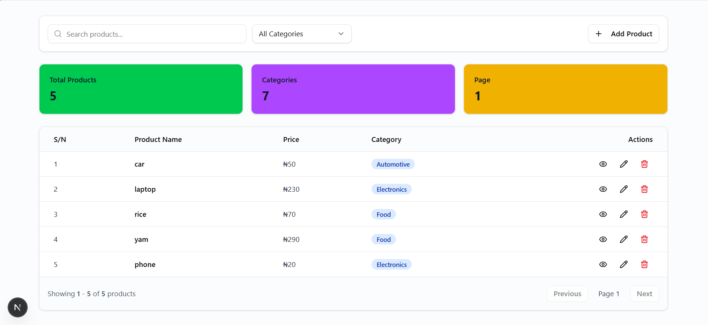
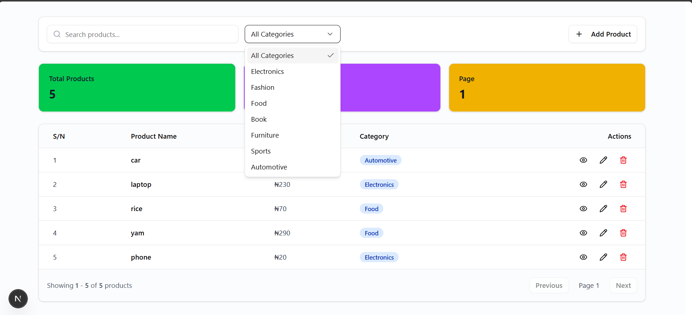
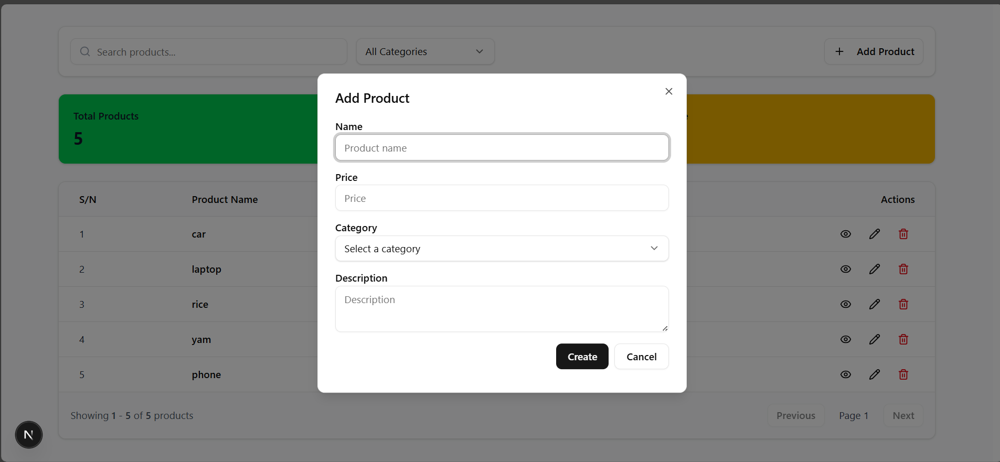
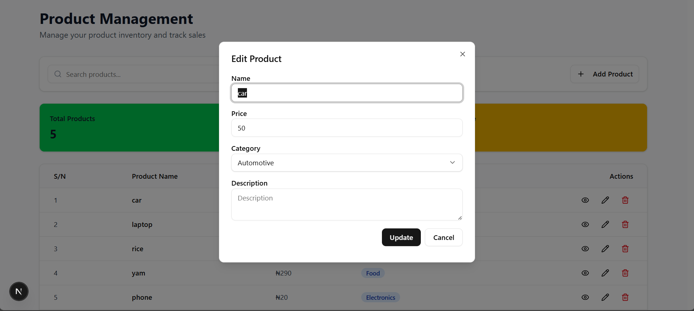

A Product Management Dashboard built with Next.js (App Router) and TypeScript, allowing users to view, filter, search, and manage products using a mock REST API.

Features Implemented So Far

Product listing in a table

Products displayed from newest to oldest

Search products by name

Filter products by category

Pagination with next/previous controls

Add product modal

Edit product modal

Delete product confirmation modal

Product details modal

Loading and empty states

 Important Note About the Mock API

 Category handling
 Product categories are limited to predefined options
 Categories cannot be written manually
This design decision ensures: Consistent filtering
No duplicate or invalid categories
Cleaner data structure

Defined categories include:
 Electronics
 Fashion
 Food
 Book
Furniture
 Sports
 Automotive

##  Technical Decisions (Brief)

Controlled category selection was chosen over free text input to maintain data consistency
Debounced search improves performance and user experience
Pagination prefetching is used to determine the availability of the next page
Modal-based UI keeps the interface clean and focused

Newly added products do not always appear at the top of the table.

This is due to limitations of the mock API used for this project:

The mock API does not reliably store or return createdAt timestamps

Some newly created products are returned without a proper creation date

As a result, true chronological sorting cannot be guaranteed by the API

 What I’ve Done to Handle This

Requested products from the API using:

sortBy=createdAt

order=desc

Added a client-side fallback sorting strategy:

Sort by createdAt when available

Fallback to product id when timestamps are missing

This ensures the best possible ordering given the API constraints, while keeping pagination and filtering functional.

Tech Stack

Next.js 14 (App Router)

TypeScript (strict mode)

React Query

Tailwind CSS

shadcn/ui

Lucide Icons

Mock REST API

 Screenshots

### Product List

### Category Filter

### Add Product Modal

### Edit Product Modal
